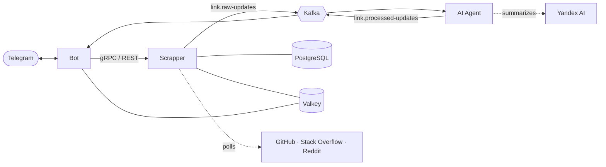

<div align="center">

# LinkTracker

**Track updates on links and get them in Telegram.**
Send a link to the bot and it tells you about new issues, pull requests, answers and posts. Long updates are summarized, noise is filtered out and related events arrive as one message.

**English** · [Русский](README.ru.md)

[](https://github.com/Echways/LinkTracker/actions/workflows/ci.yml)
[](https://dotnet.microsoft.com/)
[](LICENSE)

</div>

## Why LinkTracker

Checking a repository, a question or a subreddit by hand does not scale. LinkTracker watches the sources for you and sends only what is worth reading.

- **A bot in the chat.** `/track` walks through a dialog with an optional set of tags, `/list` shows what is tracked, `/untrack` removes a link.
- **Three sources.** GitHub repositories (issues and pull requests), Stack Overflow questions (answers and comments) and subreddits (posts).
- **An AI agent between the services.** It drops stop words and excluded authors, summarizes long text with Yandex AI, ranks updates by priority and groups them in a time window.
- **Reliable delivery.** A transactional outbox in the Scrapper, Kafka with dead-letter topics, retries and a circuit breaker on HTTP calls.
- **Fast reads.** A Valkey cluster caches the list of links; `GET /links` drops from 50 ms to 5 ms on average.
- **Your language per chat.** English by default, Russian through `/language`.
- **Observable.** OpenTelemetry metrics, a provisioned Grafana dashboard and a memory alert.
- **Tested.** Unit and Testcontainers integration tests, a build, format and test pipeline in CI.

## Architecture



| Service  | Role                                                                          | Ports (REST · gRPC · metrics) |
| -------- | ----------------------------------------------------------------------------- | ----------------------------- |
| Bot      | Telegram commands, dialogs, languages, notifications                          | 8091 · 8092 · 8011            |
| Scrapper | Subscriptions, periodic source polling, diff detection, outbox                | 8081 · 8082 · 8081            |
| AI Agent | Filtering, summarization, prioritization and grouping of updates              | 8101 · – · 8102               |

More in [Architecture](docs/en/architecture.md).

## Quick start

Create the environment files and set real values:

```bash
cp deploy/.env.template deploy/.env
cp src/LinkTracker.Bot.Api/.env.template src/LinkTracker.Bot.Api/.env
cp src/LinkTracker.Scrapper.Api/.env.template src/LinkTracker.Scrapper.Api/.env
cp src/LinkTracker.AiAgent.Api/.env.template src/LinkTracker.AiAgent.Api/.env
```

`SERVICE_AUTH_SECRET` in `deploy/.env` and `ServiceAuth__Secret` in the Bot and Scrapper files must be the same string. Run everything in containers:

```bash
docker compose -f deploy/docker-compose.yml -f deploy/docker-compose.apps.yml up
```

Or run the infrastructure in Docker and the services with the .NET 9 SDK:

```bash
docker compose -f deploy/docker-compose.yml up -d
dotnet run --project src/LinkTracker.Scrapper.Api
dotnet run --project src/LinkTracker.Bot.Api
dotnet run --project src/LinkTracker.AiAgent.Api
```

Details, tokens and settings are in [Getting started](docs/en/getting-started.md).

## Bot commands

| Command            | Action                                       |
| ------------------ | -------------------------------------------- |
| `/start`           | Register the chat                            |
| `/help`            | List the commands                            |
| `/track`           | Start tracking a link, with optional tags    |
| `/untrack <url>`   | Stop tracking a link                         |
| `/list`            | Show tracked links                           |
| `/language`        | Choose the bot language                      |
| `/cancel`          | Cancel the current dialog                    |

## Supported sources

| Source         | Link                                          | Updates                  |
| -------------- | --------------------------------------------- | ------------------------ |
| GitHub         | `https://github.com/owner/repo`               | New issues, pull requests |
| Stack Overflow | `https://stackoverflow.com/questions/12345/…` | New answers, comments    |
| Reddit         | `https://reddit.com/r/dotnet`                 | New posts                |

## Load test

100 000 links, 1 000 users, about 100 links per user. The Valkey cache shows on `GET /links`:

| `GET /links` metric  | No cache  | Valkey    | Change   |
| -------------------- | --------: | --------: | -------: |
| RPS                  |     70.85 |     76.83 |   +8.44% |
| Average latency      |  50.44 ms |   5.30 ms |  -89.49% |
| p50                  |  19.52 ms |   2.95 ms |  -84.88% |
| p99                  | 283.45 ms |  19.76 ms |  -93.03% |
| Responses 200        |    25 507 |    29 482 |   +3 975 |
| Errors 500/502/504   |         0 |         0 | no change |

## Documentation

|                                                  |                                                    |
| ------------------------------------------------ | -------------------------------------------------- |
| [Getting started](docs/en/getting-started.md)    | Tokens, environment files, local and container run |
| [Architecture](docs/en/architecture.md)          | Services, data flow, topics, storage               |
| [Configuration](docs/en/configuration.md)        | Settings of every service                          |
| [Bot](docs/en/bot.md)                            | Commands, dialogs, languages                       |
| [Scrapper](docs/en/scrapper.md)                  | Sources, scheduling, API, outbox                   |
| [AI Agent](docs/en/ai-agent.md)                  | Filtering, summaries, priorities, grouping         |
| [Observability](docs/en/observability.md)        | Metrics, Prometheus, Grafana, alerts               |
| [Development](docs/en/development.md)            | Structure, tests, CI                               |

## License

[MIT](LICENSE)
