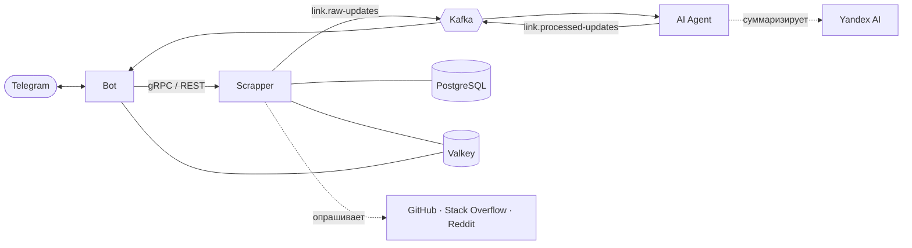

<div align="center">

# LinkTracker

**Отслеживание обновлений по ссылкам с уведомлениями в Telegram.**
Отправьте боту ссылку, и он сообщит о новых issue, pull request'ах, ответах и постах. Длинные обновления суммаризируются, шум отфильтровывается, связанные события приходят одним сообщением.

[English](README.md) · **Русский**

[](https://github.com/Echways/LinkTracker/actions/workflows/ci.yml)
[](https://dotnet.microsoft.com/)
[](LICENSE)

</div>

## Зачем LinkTracker

Проверять репозиторий, вопрос или сабреддит вручную не масштабируется. LinkTracker следит за источниками и присылает только то, что стоит прочитать.

- **Бот в чате.** `/track` ведёт по диалогу с необязательным набором тегов, `/list` показывает отслеживаемое, `/untrack` убирает ссылку.
- **Три источника.** Репозитории GitHub (issue и pull request'ы), вопросы Stack Overflow (ответы и комментарии) и сабреддиты (посты).
- **ИИ-агент между сервисами.** Отбрасывает стоп-слова и исключённых авторов, суммаризирует длинный текст через Yandex AI, расставляет приоритеты и группирует обновления по временному окну.
- **Надёжная доставка.** Transactional outbox в Scrapper, Kafka с dead-letter топиками, повторы и circuit breaker на HTTP-вызовах.
- **Быстрое чтение.** Кластер Valkey кэширует список ссылок: `GET /links` ускоряется с 50 мс до 5 мс в среднем.
- **Свой язык у каждого чата.** Английский по умолчанию, русский через `/language`.
- **Наблюдаемость.** Метрики OpenTelemetry, готовый дашборд Grafana и алерт по памяти.
- **Тесты.** Unit-тесты и интеграционные тесты на Testcontainers, сборка, проверка форматирования и тесты в CI.

## Архитектура



| Сервис   | Роль                                                                    | Порты (REST · gRPC · метрики) |
| -------- | ----------------------------------------------------------------------- | ----------------------------- |
| Bot      | Команды Telegram, диалоги, языки, уведомления                           | 8091 · 8092 · 8011            |
| Scrapper | Подписки, периодический опрос источников, поиск изменений, outbox       | 8081 · 8082 · 8081            |
| AI Agent | Фильтрация, суммаризация, приоритизация и группировка обновлений        | 8101 · – · 8102               |

Подробнее в разделе [Архитектура](docs/ru/architecture.md).

## Быстрый старт

Создайте env-файлы и впишите настоящие значения:

```bash
cp deploy/.env.template deploy/.env
cp src/LinkTracker.Bot.Api/.env.template src/LinkTracker.Bot.Api/.env
cp src/LinkTracker.Scrapper.Api/.env.template src/LinkTracker.Scrapper.Api/.env
cp src/LinkTracker.AiAgent.Api/.env.template src/LinkTracker.AiAgent.Api/.env
```

`SERVICE_AUTH_SECRET` в `deploy/.env` и `ServiceAuth__Secret` в файлах Bot и Scrapper должны быть одной и той же строкой. Запуск всего в контейнерах:

```bash
docker compose -f deploy/docker-compose.yml -f deploy/docker-compose.apps.yml up
```

Или инфраструктура в Docker, а сервисы через .NET 9 SDK:

```bash
docker compose -f deploy/docker-compose.yml up -d
dotnet run --project src/LinkTracker.Scrapper.Api
dotnet run --project src/LinkTracker.Bot.Api
dotnet run --project src/LinkTracker.AiAgent.Api
```

Токены и настройки описаны в разделе [Начало работы](docs/ru/getting-started.md).

## Команды бота

| Команда            | Действие                                     |
| ------------------ | -------------------------------------------- |
| `/start`           | Зарегистрировать чат                         |
| `/help`            | Показать список команд                       |
| `/track`           | Начать отслеживать ссылку, с тегами по желанию |
| `/untrack <url>`   | Перестать отслеживать ссылку                 |
| `/list`            | Показать отслеживаемые ссылки                |
| `/language`        | Выбрать язык бота                            |
| `/cancel`          | Отменить текущий диалог                      |

## Поддерживаемые источники

| Источник       | Ссылка                                        | Обновления                |
| -------------- | --------------------------------------------- | ------------------------- |
| GitHub         | `https://github.com/owner/repo`               | Новые issue, pull request'ы |
| Stack Overflow | `https://stackoverflow.com/questions/12345/…` | Новые ответы, комментарии |
| Reddit         | `https://reddit.com/r/dotnet`                 | Новые посты               |

## Нагрузочное тестирование

100 000 ссылок, 1 000 пользователей, около 100 ссылок на пользователя. Эффект кэша Valkey виден на `GET /links`:

| Метрика `GET /links` | Без кэша  | С Valkey  | Изменение |
| -------------------- | --------: | --------: | --------: |
| RPS                  |     70.85 |     76.83 |    +8.44% |
| Средняя задержка     |  50.44 ms |   5.30 ms |   -89.49% |
| p50                  |  19.52 ms |   2.95 ms |   -84.88% |
| p99                  | 283.45 ms |  19.76 ms |   -93.03% |
| Ответы 200           |    25 507 |    29 482 |    +3 975 |
| Ошибки 500/502/504   |         0 |         0 | без изменений |

## Документация

|                                                  |                                                    |
| ------------------------------------------------ | -------------------------------------------------- |
| [Начало работы](docs/ru/getting-started.md)      | Токены, env-файлы, локальный и контейнерный запуск |
| [Архитектура](docs/ru/architecture.md)           | Сервисы, поток данных, топики, хранилища           |
| [Конфигурация](docs/ru/configuration.md)         | Настройки каждого сервиса                          |
| [Бот](docs/ru/bot.md)                            | Команды, диалоги, языки                            |
| [Scrapper](docs/ru/scrapper.md)                  | Источники, расписание, API, outbox                 |
| [ИИ-агент](docs/ru/ai-agent.md)                  | Фильтрация, суммаризация, приоритеты, группировка  |
| [Наблюдаемость](docs/ru/observability.md)        | Метрики, Prometheus, Grafana, алерты               |
| [Разработка](docs/ru/development.md)             | Структура, тесты, CI                               |

## Лицензия

[MIT](LICENSE)
