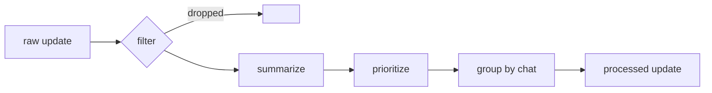

# AI Agent

[English](ai-agent.md) · [Русский](../ru/ai-agent.md) · [Documentation](README.md)

The AI Agent sits between the Scrapper and the Bot. It reads `link.raw-updates`, improves what users will see and writes `link.processed-updates`.

## Pipeline

Updates of kind `SystemReport` skip the pipeline and go straight to the output.

## Filtering

An update is dropped when any rule matches:

| Rule | Setting |
| ---- | ------- |
| Text shorter than the minimum | `AiAgent:Filtering:MinLength` |
| Author in the exclusion list, ignoring case | `AiAgent:Filtering:ExcludedAuthors` |
| Text contains a stop word, ignoring case | `AiAgent:Filtering:StopWords` |

## Summarization

Text longer than `AiAgent:Summarization:Threshold` is sent to Yandex AI with the instruction to summarize it in two or three sentences, in Russian. Shorter text passes unchanged.

If Yandex AI fails or returns nothing, the text is truncated to the threshold and the update still goes out. Each fallback is counted in `summarization_fallbacks_total` with the reason, so degraded summaries show up on the dashboard.

## Prioritization

| Priority | When |
| -------- | ---- |
| High | The text contains a word from `HighKeywords` |
| Low | The text contains a word from `LowKeywords` and no high word |
| Medium | Anything else |

## Grouping

For every chat the agent buffers updates for `AiAgent:Grouping:WindowMs`. When the window closes, a background job flushes the buffer. A single update goes out as is. Several become one numbered message, `1. [url] text`, with the highest priority of the group.

Offsets are acknowledged only after a buffered update is published, so a crash replays the buffer rather than losing it.

## Failure handling

A raw message that fails after `RetryAttempts` goes to `link.raw-updates-dlq` with the error, and consumption continues.
