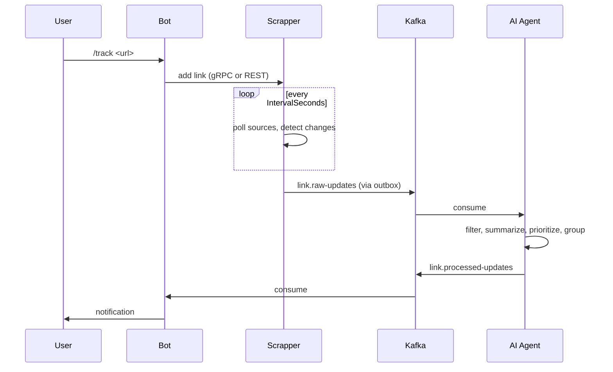

# Architecture

[English](architecture.md) · [Русский](../ru/architecture.md) · [Documentation](README.md)

LinkTracker is three .NET 9 services that talk over REST, gRPC and Kafka, plus PostgreSQL, Kafka and Valkey.

## Data flow

1. The Bot registers the chat and manages links through the Scrapper.
2. The Scrapper polls GitHub, Stack Overflow and Reddit on a schedule and compares the result with the stored state.
3. A detected change is written to the outbox in the same database transaction. A background dispatcher publishes it to `link.raw-updates`.
4. The AI Agent consumes raw updates, processes them and publishes the result to `link.processed-updates`.
5. The Bot consumes processed updates and sends them to the chats.

## Services

| Service | Projects | Endpoints |
| ------- | -------- | --------- |
| Bot | `Bot.Api`, `Bot.Application`, `Bot.Infrastructure`, `Bot.Presentation` | REST `8091` (`POST /updates`, `GET /health`), gRPC `8092`, metrics `8011` |
| Scrapper | `Scrapper.Api`, `Scrapper.Application`, `Scrapper.Infrastructure`, `Scrapper.Presentation`, `Scrapper.Storage.*` | REST `8081`, gRPC `8082` |
| AI Agent | `AiAgent.Api`, `AiAgent.Application`, `AiAgent.Infrastructure` | REST `8101`, metrics `8102` |

Each service is split into API, Application (use cases and abstractions) and Infrastructure (clients, storage, Kafka). `LinkTracker.Shared` holds contracts, protobuf files, authentication and resilience. `LinkTracker.EnvReader` loads `.env` files.

## Transports

The Bot talks to the Scrapper over `Scrapper:Transport` (`Http` or `Grpc`). The Scrapper delivers updates to the Bot over `Bot:Transport` (`Http`, `Grpc` or `Kafka`). With `Kafka` the updates take the full route through the AI Agent. Requests between the Bot and the Scrapper carry the header `x-service-token` with the shared secret.

## Kafka topics

| Topic | Producer | Consumer | Purpose |
| ----- | -------- | -------- | ------- |
| `link.raw-updates` | Scrapper | AI Agent | Updates as found |
| `link.raw-updates-dlq` | AI Agent | | Raw updates that failed after retries |
| `link.processed-updates` | AI Agent | Bot | Updates ready to send |
| `link.processed-updates-dlq` | Bot | | Processed updates that failed after retries |

Topics have 6 partitions, replication factor 3 and `min.insync.replicas=2`. Offsets are committed after processing. Payloads are JSON; Schema Registry is available for other serializations.

## Storage

| Store | Used by | Holds |
| ----- | ------- | ----- |
| PostgreSQL | Scrapper | Chats, links, tags, check state, outbox. Schema in [migrations/](../../migrations/), applied by DbUp. |
| Valkey | Scrapper, Bot | Cached link lists (`LinksTtlSeconds`, with client-side caching) and dialog state (`DialogTtlSeconds`). |

The Scrapper can reach PostgreSQL through plain SQL or an ORM, chosen by `Database:AccessType` (`Sql` or `Orm`).

## Reliability

- **Transactional outbox.** A message is stored with the data change and dispatched later, so a Kafka outage does not lose updates. Dispatching is leased, retried up to `MaxRetryCount` times and batched.
- **Dead-letter topics.** A message that fails after `RetryAttempts` goes to a DLQ topic instead of blocking the partition.
- **HTTP resilience.** Timeout, retries on `408`, `429`, `5xx` and a circuit breaker on every outgoing HTTP client.
- **Source rate limits.** A token bucket per source keeps the Scrapper within GitHub, Stack Overflow and Reddit quotas.
- **API rate limit.** Public routes are limited per `Tg-Chat-Id`, not per IP, because all bot traffic arrives from one address.
