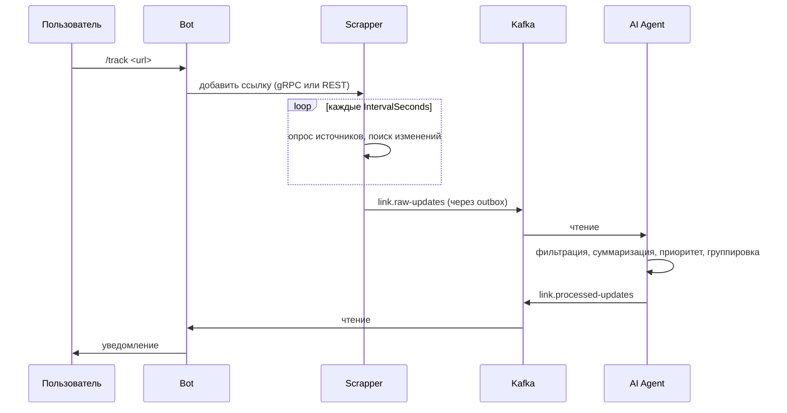

# Архитектура

[English](../en/architecture.md) · [Русский](architecture.md) · [Документация](README.md)

LinkTracker — три сервиса на .NET 9, которые общаются по REST, gRPC и Kafka, плюс PostgreSQL, Kafka и Valkey.

## Поток данных

1. Bot регистрирует чат и управляет ссылками через Scrapper.
2. Scrapper по расписанию опрашивает GitHub, Stack Overflow и Reddit и сравнивает результат с сохранённым состоянием.
3. Найденное изменение пишется в outbox в той же транзакции БД. Фоновый диспетчер публикует его в `link.raw-updates`.
4. AI Agent читает сырые обновления, обрабатывает их и публикует результат в `link.processed-updates`.
5. Bot читает обработанные обновления и отправляет их в чаты.

## Сервисы

| Сервис | Проекты | Эндпоинты |
| ------ | ------- | --------- |
| Bot | `Bot.Api`, `Bot.Application`, `Bot.Infrastructure`, `Bot.Presentation` | REST `8091` (`POST /updates`, `GET /health`), gRPC `8092`, метрики `8011` |
| Scrapper | `Scrapper.Api`, `Scrapper.Application`, `Scrapper.Infrastructure`, `Scrapper.Presentation`, `Scrapper.Storage.*` | REST `8081`, gRPC `8082` |
| AI Agent | `AiAgent.Api`, `AiAgent.Application`, `AiAgent.Infrastructure` | REST `8101`, метрики `8102` |

Каждый сервис разделён на API, Application (сценарии и абстракции) и Infrastructure (клиенты, хранилища, Kafka). В `LinkTracker.Shared` лежат контракты, protobuf-файлы, аутентификация и отказоустойчивость. `LinkTracker.EnvReader` загружает `.env`.

## Транспорты

Bot обращается к Scrapper через `Scrapper:Transport` (`Http` или `Grpc`). Scrapper доставляет обновления в Bot через `Bot:Transport` (`Http`, `Grpc` или `Kafka`). При `Kafka` обновления проходят полный путь через AI Agent. Запросы между Bot и Scrapper несут заголовок `x-service-token` с общим секретом.

## Топики Kafka

| Топик | Производитель | Потребитель | Назначение |
| ----- | ------------- | ----------- | ---------- |
| `link.raw-updates` | Scrapper | AI Agent | Обновления как найдены |
| `link.raw-updates-dlq` | AI Agent | | Сырые обновления, не обработанные после повторов |
| `link.processed-updates` | AI Agent | Bot | Обновления, готовые к отправке |
| `link.processed-updates-dlq` | Bot | | Обработанные обновления, не доставленные после повторов |

У топиков 6 партиций, фактор репликации 3 и `min.insync.replicas=2`. Оффсеты коммитятся после обработки. Сообщения в JSON; для других сериализаций доступен Schema Registry.

## Хранилища

| Хранилище | Кто использует | Что хранит |
| --------- | -------------- | ---------- |
| PostgreSQL | Scrapper | Чаты, ссылки, теги, состояние проверок, outbox. Схема в [migrations/](../../migrations/), применяется DbUp. |
| Valkey | Scrapper, Bot | Кэш списков ссылок (`LinksTtlSeconds`, с client-side caching) и состояние диалогов (`DialogTtlSeconds`). |

Scrapper ходит в PostgreSQL через чистый SQL или ORM, это задаёт `Database:AccessType` (`Sql` или `Orm`).

## Надёжность

- **Transactional outbox.** Сообщение сохраняется вместе с изменением данных и отправляется позже, поэтому сбой Kafka не теряет обновления. Отправка идёт с lease, повторяется до `MaxRetryCount` раз и пачками.
- **Dead-letter топики.** Сообщение, не обработанное за `RetryAttempts`, уходит в DLQ и не блокирует партицию.
- **Устойчивые HTTP-вызовы.** Таймаут, повторы на `408`, `429`, `5xx` и circuit breaker на каждом исходящем HTTP-клиенте.
- **Лимиты источников.** Token bucket на каждый источник удерживает Scrapper в квотах GitHub, Stack Overflow и Reddit.
- **Лимит API.** Публичные маршруты ограничиваются по `Tg-Chat-Id`, а не по IP: весь трафик бота приходит с одного адреса.
